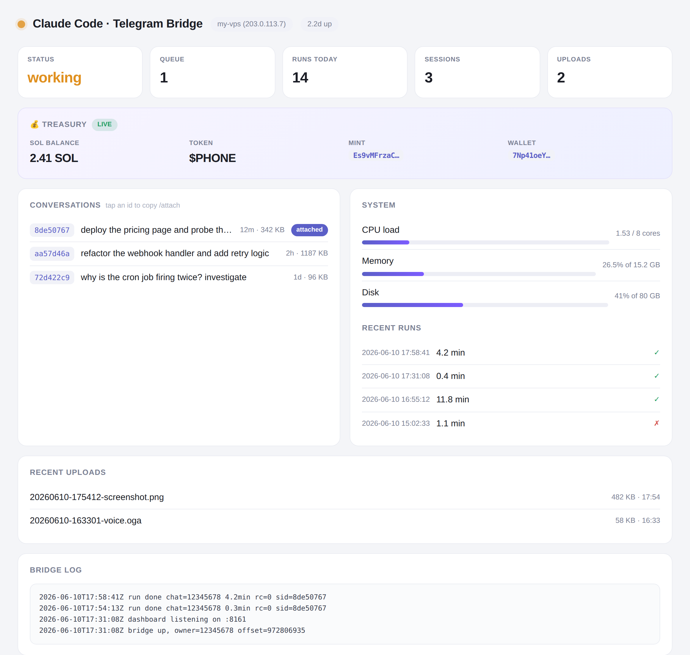

# claude-code-telegram-bridge

**Your Claude Code terminal, in your pocket.** A single-file Python daemon that turns a Telegram bot into a full [Claude Code](https://claude.com/claude-code) session — tools, memory, skills, everything — running on your own machine, owner-locked, always on.

Send a message from your phone; a real headless Claude Code turn runs on your server with full tool access and streams its replies back. Send a photo and Claude looks at it. Send a voice note and it's transcribed into the prompt. Attach to any past conversation — including ones you started in the terminal — and keep going.



## Features

- **Real Claude Code turns** — each message runs `claude -p` headless with full tool access and `--resume` continuity, so a conversation on Telegram behaves exactly like one in the terminal.
- **Session remote-control** — `/sessions` lists every Claude Code conversation on the box, `/attach <id>` continues any of them from your phone, `/last` jumps to the newest. Start something at your desk, finish it from the street.
- **Uploads in** — documents, photos, albums, video land in `UPLOAD_DIR` and their paths are injected into the turn (Claude Code reads images natively). Albums are batched into a single prompt, even when items download at different speeds.
- **Voice in** — voice notes are transcribed (ElevenLabs `scribe_v1`, falling back to Gemini) and the transcript becomes the prompt, with the audio path included. Speak your commands.
- **Files out** — `/file /path` sends any file from the server to your chat. Claude itself also gets `TG_TOKEN`/`TG_CHAT_ID` in its environment plus instructions, so it can push artifacts to you mid-task.
- **Web dashboard** — optional light-theme status page (above): live status, queue, conversations with attach-ids, recent runs, uploads, system vitals (CPU/memory/disk), and an optional Solana treasury panel. Single static HTML file served by the bridge itself, token-gated.
- **Self-healing** — broken/pruned `--resume` targets are detected (file check + error-result heuristic) and the prompt is replayed once on a fresh session instead of failing forever.
- **Ops built in** — `/stop` kills a runaway turn, `/status` and `/log` inspect the bridge, `/reboot` restarts it (offset-safe: no redelivery loop), systemd `Restart=always` keeps it up.

## Quickstart

Requirements: Linux with systemd, Python 3.10+ (stdlib only — no pip installs), and a working [Claude Code](https://claude.com/claude-code) login for the user that runs the bridge.

```bash
# 1. Get a bot token from @BotFather, and your numeric user id from @userinfobot

# 2. Install
sudo git clone https://github.com/naoufac/claude-code-telegram-bridge /opt/claude-tg-bridge
sudo chown -R "$(whoami)" /opt/claude-tg-bridge
cd /opt/claude-tg-bridge
cp .env.example .env && $EDITOR .env       # set TG_TOKEN and OWNER_ID at minimum
chmod 600 .env

# 3. Run as a service
sudo cp claude-tg-bridge.service /etc/systemd/system/
sudo systemctl daemon-reload
sudo systemctl enable --now claude-tg-bridge

# 4. Open your bot in Telegram, press Start, say hi
```

To enable the dashboard, set `DASH_PORT` and `DASH_KEY` in `.env`, open the port in your firewall, and visit `http://your-server:PORT/?key=YOUR_KEY`.

## Commands

30 commands, registered in Telegram's "/" menu at startup (`native_commands.py` is the single source).

| Command | What it does |
|---|---|
| `/go <message>` | Send a message into the running turn: Claude reads it after its next step (a hook injects it), or keeps going if it was about to stop |
| `/stop` | Kill the running turn and drain the queue |
| `/status` `/queue` `/clear` | Bridge state, waiting tasks, drop waiting tasks without stopping the current turn |
| `/new` `/resume [note]` `/retry` | Fresh conversation, continue the current one, re-run your last prompt |
| `/sessions` `/attach <id>` `/last` `/session` `/detach` | Browse and switch Claude Code sessions (8-char prefix is enough) |
| `/model [name\|default]` `/models` | Show or switch the model for the next turns |
| `/effort [low…max\|default]` | Show or set the reasoning effort |
| `/timeout [minutes]` | Turn time limit, `0` = no limit |
| `/cost` `/usage` | Cost of the last turn and running total (from Claude Code's result events) |
| `/zai <prompt>` | Run a task on a separate GLM worker command (`GLM_BIN`, prompt on stdin) |
| `/file <path>` `/workspace` | Send a file from the server, show the working directory |
| `/health` `/uptime` `/config` `/ping` `/log` | Server load/RAM/disk, uptime, configuration, liveness, log tail |
| `/reboot` | Restart the bridge process |
| `/help` `/start` | Command list |
| anything else | Runs a Claude Code turn, including `/slash` skills and `/goal`, which pass through |

Tests: `python3 -m unittest test_commands` (routing, persistence and queueing are real; only Telegram is faked).

## Security model

- **Owner-locked**: only `OWNER_ID` gets turns. Strangers get silence in groups and one throttled refusal in DMs.
- Claude runs with `--dangerously-skip-permissions` *as your user on your machine* — that is the point of the tool, but understand it: anyone who controls the owner Telegram account controls the server. Protect that account (2FA) and the bot token.
- The bot token is redacted from every outbound message; the dashboard requires a key (constant-time compared) and serves read-only state.
- A `flock` guarantees one poller per token — running a second copy exits instead of split-braining `getUpdates`.

## Design notes (the bugs you don't have to rediscover)

These came out of adversarial review and live testing:

- **stderr must be drained** in a thread, or a chatty claude child deadlocks on a full pipe mid-run.
- **getUpdates offset is saved *after* handling**, so a crash mid-handle replays the message instead of dropping it; exceptions still advance it, so a poison message can't loop the bridge.
- **`/reboot` exits only after the offset is persisted** — otherwise Telegram redelivers `/reboot` after every restart, forever.
- **A dead `--resume` id doesn't fail loudly**: claude emits an `is_error` result and echoes the requested session id back. The bridge checks the session file on disk first and heal-retries once on a fresh session.
- **Albums race**: items register with the batch buffer *before* their (variable-speed) downloads, so a slow video can't get split out of its album.
- **Media handling runs off the poller thread**, so `/stop` stays responsive during a 2-minute transcription.
- Restarting the service kills the whole cgroup, including an in-flight turn — deploy updates while idle.

## Layout

```
bridge.py                 the entire bridge (~800 lines, stdlib only)
dashboard.html            light-theme dashboard (vanilla JS, served by bridge.py)
claude-tg-bridge.service  systemd unit
.env.example              all configuration, documented
```

Built on a Hetzner VPS by Claude Code driving itself — specified, written, adversarially reviewed and live-tested over Telegram before being published. MIT.
